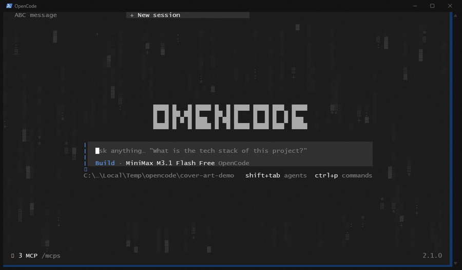
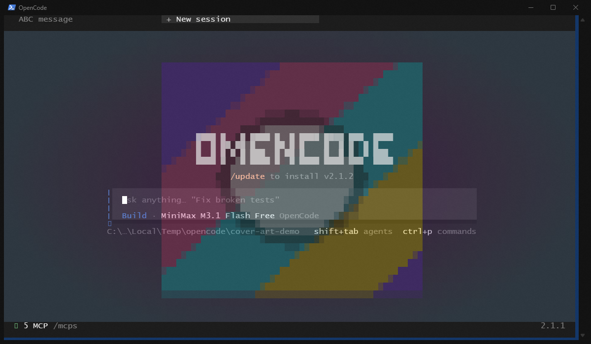

# Cover art

A translucent, theme-aware home-screen treatment for OpenCode: the real `opencode`
wordmark stays readable, while a soft digital-rain background drifts across the
home screen. The rain is masked around the wordmark, prompt, tab bar, and footer,
so text is never covered.



Part of **Kleosal OC**. Zero npm dependencies, theme-adaptive, and only active on
the home screen.

## Install

This plugin ships with the Kleosal OC pack:

```bash
# macOS / Linux
curl -fsSL https://raw.githubusercontent.com/NOOBHEKER/kleosal-oc/main/install.sh | bash
```

```powershell
# Windows
irm https://raw.githubusercontent.com/NOOBHEKER/kleosal-oc/main/install.ps1 | iex
```

Or copy this `cover-art/` folder into `~/.config/opencode/plugins/` and restart
OpenCode (on Windows: `C:\Users\<you>\.config\opencode\plugins\`). The `/art`
picker appears automatically; the MCP server is optional.

Everything is driven by the same small JSON config, so the TUI, the `/art` picker,
and the MCP server stay in sync.

## Presets

| Preset | What it does |
| --- | --- |
| `matrix` | Full-screen rain + readable tinted wordmark (default) |
| `matrix-wordmark` | Same rain with a slow breathing/shimmer on the wordmark |
| `wordmark` | Ghost wordmark only, with a slow shimmer |

By default every preset uses the **stock OpenCode logo**, not a redrawn copy. It
keeps its exact glyphs, shadows, and theme colours, so it always reads `opencode`
and follows theme changes. Only its opacity is reduced.

Set `"wordmark": "OMENCODE"` (or any 1–16 character label) to replace it with a
custom four-row block wordmark. The stock logo is hidden while the custom wordmark
is active, and the custom glyphs are painted in the post-process layer as well, so
they cannot intercept mouse events either.

The rain uses `theme.text` tokens, so it adapts to light/dark themes automatically.
It is painted straight into the renderer's frame buffer with
`renderer.addPostProcessFn`, not as a layout overlay. That gives it **no hit-test
node at all**, so it cannot swallow a tab click, a mouse-wheel event, a dialog
click, or a text selection. A mask keeps it out of every text area.

The rain frame is flattened into non-space glyph cells once per animation tick, and
colour objects are packed once per alpha instead of once per cell. The post-process
therefore skips the full screen of spaces on every repaint. `fps: 12` is a good
smooth default on a normal terminal; lower it if you want even less CPU.

## Using it

- `/art` (or the "Cover art" command palette entry) opens a picker with presets,
  custom or stock wordmark, rain faintness, full-screen vs. left-panel layout,
  custom frames, enable/disable, and reset.
- Changes apply within about half a second; no TUI restart is needed.

## Music art (now playing)

The same post-process layer can show the album art Spotify is playing right now
as a smooth, blurred ambient wash behind the UI, with a compact now-playing
widget in the empty top-right corner on the home screen. The wash is sampled
from the daemon's colour-extended frame, so it fills a wide terminal without
ever putting a hard rectangle over the prompt or a response.



Music art is driven by the companion zero-dependency daemon
[`now-playing-cover`](https://github.com/NOOBHEKER/now-playing-cover), which talks
to the Spotify API with OAuth PKCE — or, on Windows, reads the system media
session (SMTC) without a login — and writes a small snapshot plus a raw RGB24
frame. Nothing is uploaded and there is no cloud relay.

On Windows the daemon's default `auto` source uses the desktop Spotify app's
system media session first, so **Spotify Free works without OAuth**. The Web API
path requires Premium on the Spotify account that owns the developer app. On
macOS and Linux only the Web API source is available.

```bash
/music-art on       # album art while a track plays
/music-art off      # back to the matrix rain / stock background
/music-art status   # what the daemon sees right now
/music-art toggle
```

While a track is playing the matrix rain is suppressed and the art takes over
(skipping the tab bar, footer and the prompt panel). On the home screen a small
now-playing widget shows the sleeve thumbnail, track, artist, album and a
progress line in the empty top-right corner. When a session opens the widget
eases out, while the ambient wash stays behind the session, so the effect never
just disappears. Pausing or stopping fades the art back to the theme over about
two seconds, then the rain returns on its own. `musicArt` is persisted in the
same `cover-art.json`, so the choice survives a restart.

The daemon writes:

```
~/.config/now-playing-cover/now-playing.json   # state + frame path/dimensions
~/.cache/now-playing-cover/<track>.rgb        # raw RGB24 pixels
```

If `ffmpeg` is installed the daemon uses it to blur-extend the sleeve; without
`ffmpeg` it falls back to a soft average-colour gradient, and with no daemon at
all the plugin simply leaves the rain alone.

Config file:

```
~/.config/opencode/cover-art.json
```

On Windows: `C:\Users\<you>\.config\opencode\cover-art.json`.

## Configuration

```json
{
  "enabled": true,
  "preset": "matrix",
  "effect": "matrix",
  "fullscreen": true,
  "shimmer": false,
  "fps": 6,
  "size": { "width": 60, "height": 20 },
  "opacity": 0.55,
  "rainOpacity": 0.2,
  "palette": ["#6B7280", "#9CA3AF", "#D1D5DB", "#E5E7EB"],
  "frames": null,
  "colorMap": null,
  "background": null,
  "wordmark": null,
  "musicArt": false,
  "musicOpacity": 0.3
}
```

| Field | Meaning |
| --- | --- |
| `enabled` | `false` restores the stock wordmark at full opacity and hides all art |
| `effect` | `matrix`, `wordmark`, or `frames` |
| `fullscreen` | `true` (default) covers the screen with text-safe cutouts; `false` uses the compact left panel |
| `shimmer` | Slow opacity pulse on the wordmark (`matrix`/`wordmark`) |
| `fps` | Animation rate, 1–30 (default **6**) |
| `size` | Left-panel size when `fullscreen` is false: width 8–80, height 2–24 |
| `opacity` | Wordmark opacity, 0.05–1 (default **0.55** — faint but readable) |
| `rainOpacity` | Rain opacity, 0.05–1 (default **0.2**) |
| `palette` | Colours for custom frames only; the presets use theme colours |
| `frames` | Custom frame sequence (see below) |
| `colorMap` | Per-character hex colours for custom frames |
| `background` | Optional hex background behind custom frames |
| `musicArt` | `true` shows the now-playing ambient wash and home widget (default `false`) |
| `musicOpacity` | Ambient wash opacity, 0.05–1 (default **0.3** — readable prompt text) |

### Readability

In full-screen mode the rain is removed from:

- the wordmark box (plus a small halo),
- the prompt box, model line, and help line,
- the top two rows (tab bar),
- the bottom two rows (status/footer),
- the rightmost column (scrollbar).

Rain remains in the surrounding space — above the wordmark, beside the prompt,
and below it above the footer — so the screen feels covered without ever putting
glyphs behind text. Custom frames still replace the wordmark area and hide the
stock logo.

### Mouse safety

Earlier versions drew the rain as a full-screen `box` at `zIndex` 900. OpenTUI
hit-tests renderables even when they have no mouse handler, so that box sat above
the session tab strip (`zIndex` 1) and scrollboxes and blocked tab clicks, wheel
scrolling, and dialog clicks. The rain is now post-processed into the buffer, so
there is no overlay to hit. This is the permanent fix; no per-route z-index
juggling is involved.

## Custom frames

`set_frames` (or `/art` → "Custom frames from file…") replaces the wordmark area
with your own animation and hides the stock logo. Limits:

- up to **64 frames**
- each frame up to **8 rows** and **80 columns**
- printable ASCII plus block glyphs: `█ ▀ ▄ ░ ▒ ▓ ▁ ▂ ▃ ▅ ▆ ▇ ■ □ ▪ ▫`
- rows are padded to the longest row, frames to the largest frame
- unmapped characters use `palette[0]`; `colorMap` can override single characters

Example:

```json
{
  "frames": [
    ["  ▄▀▄  ", " █   █ ", "  ▀▄▀  "],
    ["  ▄▀▄  ", " █   █ ", " ▀   ▀ "]
  ],
  "fps": 6,
  "colorMap": { "█": "#7DD3FC" }
}
```

If custom art is wider than the terminal, the plugin leaves the stock wordmark
visible instead of clipping the art.

## MCP server

Configured as `mcp.servers.coverart` and started with `node mcp/server.mjs`
(zero dependencies, stdio JSON-RPC).

```jsonc
"mcp": {
  "servers": {
    "coverart": {
      "type": "local",
      "command": ["node", "/home/you/.config/opencode/plugins/cover-art/mcp/server.mjs"]
    }
  }
}
```

On Windows use a path like `C:/Users/you/.config/opencode/plugins/cover-art/mcp/server.mjs`.
The Kleosal OC installer prints the exact entry with your path.

| Tool | Purpose |
| --- | --- |
| `list_presets` | List presets with effect, size, opacity, rain opacity, fps |
| `get_config` | Current config plus the shared config path |
| `set_preset` | Switch preset (`matrix`, `matrix-wordmark`, `wordmark`) |
| `set_frames` | Apply custom frames (`frames`, optional `fps`, `palette`, `colorMap`) |
| `set_options` | Change `enabled`, `fullscreen`, `fps`, `size`, `opacity`, `rainOpacity`, `palette`, `background` |
| `preview_frames` | Validate frames and print one as text without applying |
| `reset` | Restore the default full-screen rain |

## How it works

- `tui.tsx` locates the stock logo in the render tree and dims it with `opacity`
  (setting `visible = false` would collapse its wrapper and shift the layout).
- In full-screen mode the rain is generated as text spans and painted directly
  into the frame buffer by a post-process callback. A mask excludes the wordmark,
  the prompt container (found from the "Ask anything…" placeholder, with a
  geometric fallback), the top tab bar, the footer, and the scrollbar.
- Because the rain is post-processed, it has no renderable and no z-index. There
  is nothing for OpenTUI's mouse hit test to select, so tabs, scrollboxes, and
  dialogs keep working normally. The callback is removed on cleanup and is also
  skipped while a dialog or menu is open.
- Custom frames still use a small absolutely positioned canvas around the
  wordmark. That canvas sits at `zIndex` 0 (below tabs `zIndex` 1 and the prompt
  `zIndex` 1000) and is hidden with `visible = false` when inactive.
- `engine.ts` draws the rain and frame art as coloured spans, using theme tokens
  for presets and `palette`/`colorMap` for custom frames. Full-screen columns use
  short, slow trails so the background stays calm.
- `shared.mjs` owns defaults, validation, and atomic reads/writes of the JSON
  config. `mcp/server.mjs` exposes it over MCP.
- In music mode the daemon's blurred frame is sampled bilinearly into space-cell
  backgrounds, which preserves existing glyphs and tints them instead of covering
  them. The home widget is also cell backgrounds, plus a few title/artist glyphs
  confined to the empty top-right corner. When a session opens the widget eases
  out and its glyphs are explicitly erased, while the ambient wash continues on
  every route. Because the rain is suppressed, the plugin calls
  `renderer.requestRender()` on every music tick; otherwise the first painted
  frame would stay frozen.
- `index.ts` is a no-op server-side entry so the plugin directory is valid for
  both discovery paths.

Rain, frames and the custom wordmark remain home-only. The music ambient is the
one layer that intentionally stays behind session views.
